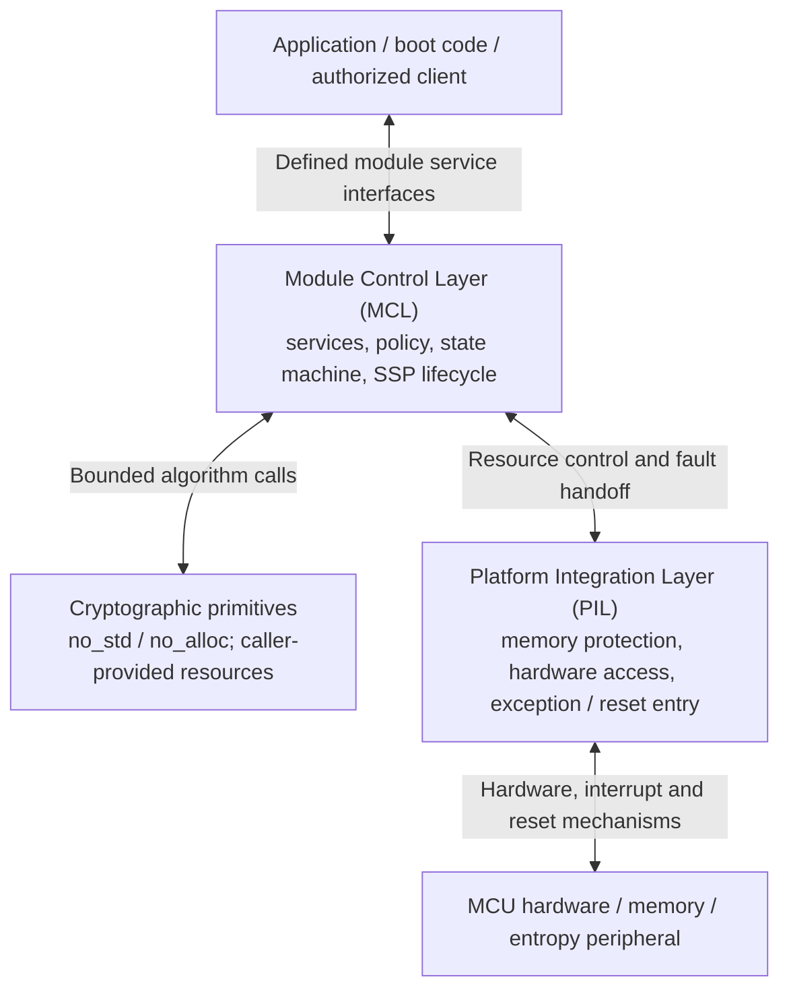

# Embedded-Crypto Architecture

**Status:** Draft for design review; MCL finite-state details remain open  
**Last reviewed:** 2026-10-20  
**Repository:** `kytheros-com/embedded-crypto`  
**Review baseline:** `main` at `6675ba7a434dbf9112c6bc0693249d05771a5f78`  
**Working branch:** `design-requirements-audit/2026-10-19`

## 1. Purpose and scope

This document defines the architecture for the Kytheros `embedded-crypto` project.

The project distinguishes three logical architectural layers:

1. **Cryptographic primitives** implement specified algorithms, expose bounded and explicit interfaces, and supply algorithm-level evidence.
2. The **Platform Integration Layer (PIL)** implements narrowly scoped platform-dependent mechanisms for memory placement, protection and zeroization; hardware access; reset and exception entry; and privilege transitions.
3. The **Module Control Layer (MCL)** controls external module service interfaces, cryptographic dispatch, state transitions, self-test coordination, SSP lifecycle and the selected security policy.

These are logical responsibilities, not necessarily separate crates, binaries, security domains or validation boundaries. The complete cryptographic boundary and module embodiment remain open under Q-001.

## 2. Architectural principles

- **Separation of concerns.** A primitive implements an algorithm, not an entire module security policy. The PIL implements platform mechanisms, not cryptographic-service policy. The MCL orchestrates and enforces security policy.
- **Portable embedded core.** Production primitive paths shall be designed from the outset for `no_std` and without `alloc`, operating before an OS or fully configured MMU exists. A hosted test harness may use `std` without changing the embedded runtime contract.
- **Explicit resource ownership.** No production primitive may implicitly obtain heap storage or assume a privileged runtime service. Callers supply storage and dependencies under documented size, alignment, lifetime, and access contracts.
- **Small, reviewable trusted mechanisms.** Prefer safe Rust for portable primitives. Any unavoidable `unsafe` code shall be narrowly contained, justified, reviewed, and tested in the component requiring it; the present workspace-level `unsafe_code = "forbid"` policy must not be weakened globally without an explicit design decision.
- **No claims by association.** Correctness, memory safety, algorithm testing, module validation, side-channel behavior, and physical security are different properties, requiring separately identified evidence.
- **Traceable change control.** Architecture changes are reviewed for effects on design, requirements, interfaces, security behavior, tests, and evidence before being accepted.

## 3. Authoritative records and document relationships

The source of truth for the **CMVP planning baseline** is:

`docs/assurance/CMVP_Level_1_Software_Requirements_Matrix.xlsx`

which we often refer to simply as **The Workbook**. Its relevant worksheets include `Source Register`, `Requirements`, `Design Decisions`, `Open Questions`, `Service Contracts`, `SSP Plan`, `ISO Level 1 Index`, and `Evidence Plan`. Preserve their stable requirement, decision, question, assertion, and evidence identifiers.

- **This document** defines the logical architecture, component responsibilities, interface boundaries, and the design principles that implement recorded decisions.
- **The Workbook** records controlling sources, normative applicability, project requirements, decision status, planned services, evidence ownership and completion state.
- **`docs/assurance/project-scope.md`** defines assurance claims and the division between this project and a third-party integrating module. This architecture refines, but must not contradict, that scope.
- **Algorithm-specific design and test documents** provide per-algorithm APIs, invariants, scratch memory requirements, test coverage, and evidence; they cite Workbook identifiers rather than duplicating full normative requirements.

Any discrepancy between these documents is an error and should be reported and resolved.

## 4. Logical architecture

### 4.1 Cryptographic primitives

The cryptographic primitives have these principal responsibilities:

- Conformance to a named algorithm specification, revision, supported parameter set, and defined operation; input validation and deterministic algorithm behavior as applicable.
- Explicit algorithm state and working-storage contracts, including bounded maximum storage and stack requirements for supported configurations.
- Correctness of internal state transitions, error handling, and relevant cleanup of primitive-owned temporary secrets.
- Algorithm-level development tests and evidence, including known-answer and boundary tests, and independent comparisons when available.
- Documentation of side-channel assumptions, implementation variants, and limitations of available assurance.
- An algorithm requiring random inputs declares the exact kind and amount of material needed (for example, deterministic seeds, DRBG-generated bits, or entropy inputs for a DRBG mechanism). Ordinary algorithms do not independently discover hardware sources or fetch entropy; externally supplied inputs are subject to the algorithm's specific contract.

### 4.2 Platform Integration Layer (PIL)

The Platform Integration Layer has these principal responsibilities:

- Binding each supported target to fixed or statically assigned memory regions for module state, CSPs and other SSPs, plaintext, primitive workspaces, and sensitive execution stacks where required.
- Applying the selected platform's access-control mechanisms and privilege/security-domain configuration and transitions.
- Ownership of target-specific reset, fault and relevant interrupt-vector entry points, early platform exception handling, hardware fault/reset-cause capture and controlled handoff to the MCL where the processor remains capable of execution.
- Narrowly scoped access to other hardware-dependent services, including entropy-peripheral interfaces and reset-status mechanisms.
- Platform-appropriate mechanisms for MCL-requested zeroization, memory-region retirement, and protection of sensitive locations outside a primitive's direct control.
- The justification, containment, review, and platform testing of necessary `unsafe` Rust operations.

### 4.3 Module Control Layer (MCL)

The Module Control Layer has these principal responsibilities:

- Control of the module's defined external service interfaces, including service inputs, outputs, authorization and status reporting. The MCL is not by itself the complete cryptographic boundary.
- Ownership of the module finite-state machine and enforcement of allowable state transitions.
- Enforcement of the selected security configuration, including output inhibition, SSP lifecycle policy, and required self-test sequencing.
- Coordination with the PIL for bounded protected memory, hardware-source access, and fault/reset handoff; and with primitives for algorithm execution.
- Assessment of retained FSM state following a reset or fault. Unverified or inconsistent retained state shall not be trusted to justify resumption of cryptographic services.

**NOTE:** The actual cryptographic boundary and embodiment remain an explicitly open design matter (Q-001).

## 5. Interface and ownership contracts

The following contracts describe **architectural requirements**, not completed API signatures. Exact types and failure semantics are defined in component design documents and accepted through review.

| Concern | Cryptographic primitives | Platform Integration Layer | Module Control Layer |
| --- | --- | --- | --- |
| Inputs and outputs | Specify formats, lengths, alignment and overlap restrictions; reject invalid inputs with defined behavior | Make protected regions accessible only to authorized call paths | Authorize services, validate caller permissions, classify boundary-crossing data |
| Working storage | Declare bounded scratch/state needs; use only explicitly supplied or bounded local storage | Reserve and protect selected fixed regions, including sensitive stacks/scratch | Allocate resources to operations, prevent conflicting reuse and aliasing |
| Randomness | Document algorithm-specific seed, pseudorandom-bit or entropy-input requirements; do not access the hardware source implicitly | Provide target-specific entropy-source access and status | Qualify/instantiate the RBG, authorize random inputs, enforce reseed policy and service availability |
| SSP handling | Identify sensitive intermediates and cleanup contract; avoid uncontrolled copies | Protect, isolate and externally zeroize applicable memory regions | Own SSP inventory, usage authorization, lifetime, import/export and module zeroization policy |
| Failures | Distinguish specified negative outcomes from unexpected internal faults; document state and outputs | Own applicable vector/exception entry, capture fault context, provide trusted cleanup mechanisms | Treat unexpected primitive faults as potential active attacks; inhibit services and order zeroization of every region the primitive could modify |
| Tests and evidence | Supply algorithm-level tests, vectors and build/implementation records | Supply target isolation, exception/reset-path, memory cleanup and hardware configuration evidence | Orchestrate applicable module self-tests and integration tests; produce module-level validation evidence |

### 5.1 Operation lifecycle, faults and sensitive-memory cleanup

The module distinguishes **specified service outcomes** from **unexpected internal
errors and processor faults**. Rejection of invalid input, unsuccessful signature
verification and other documented negative results are ordinary service
outcomes, not evidence of an implementation fault. An internal error that should
not occur during correct operation is treated **by policy as a possible active
attack**, irrespective of whether an attack has been demonstrated.

1. **Reset and early entry:** On power-on, processor reset or relevant
   exception entry, the PIL owns the applicable target vectors and early handler.
   Where the processor remains capable of controlled execution, the PIL obtains
   the available reset/fault context, establishes a sufficiently trustworthy
   execution path, and transfers control and fault information to the MCL.
   Cryptographic services and sensitive outputs remain inhibited until the
   MCL has established that operation is permitted. The MCL may inspect retained
   FSM state but shall not rely on it without an appropriate integrity and
   validity determination. If that determination fails, the conservative
   recovery and zeroization policy applies. The distinct rules for cold reset,
   warm reset, watchdog reset and processor faults remain open under Q-008.

2. **Before invocation:** The MCL authorizes the requested service, checks
   relevant FSM constraints and assigns the required working regions under PIL
   memory and access-control mechanisms. The module maintains **trusted
   records independent of the primitive** identifying every memory region
   that the primitive can modify under its actual execution configuration,
   including writable caller buffers, working storage and applicable stacks.
   Region lifetimes, aliasing and concurrency must satisfy the primitive API
   contract.

3. **During invocation:** The primitive accesses only memory permitted by its
   documented contract. Primitive-created temporary state and possible copies,
   register values, stack usage and workspace sensitivity are documented.
   Writable buffers are not assumed disjoint unless language or API
   guarantees establish this.

4. **On specified completion:** The primitive performs its documented
   cleanup of sensitive temporary state. The MCL then directs the PIL to
   zeroize released sensitive regions. Retained, authorized outputs and
   long-lived SSPs are governed by their explicit lifecycle contracts, rather
   than accidentally erased as scratch. Documented negative service outcomes
   follow this completion path.

5. **On unexpected internal error or fault:** The module assumes a possible
   active attack. The MCL inhibits affected cryptographic services and
   commands the PIL to **zeroize every memory region that the primitive was
   capable of modifying**, without narrowing the wipe to locations believed
   to have been altered. The applicable set is determined from trusted
   resource/access records and actual protections, not from metadata supplied
   by the failed primitive. The set includes writable output buffers and
   sensitive regions where the primitive had write capability. Faults that
   bypass normal return reach the PIL through the applicable hardware
   exception/reset path; whenever the MCL can safely execute, the PIL passes
   the fault context and control to the MCL for the security response. The
   module shall not resume affected services before the prescribed
   zeroization, safe reinitialization and applicable tests have succeeded.

6. **When normal recovery cannot execute:** A fault may prevent the MCL or
   even the PIL from executing. The available platform mechanisms must
   prevent affected state from being used or exposed through subsequent
   services until the required zeroization has been established. The target
   design must analyze retained SRAM, reset-cause evidence, persistent FSM
   metadata, early-boot access controls, interrupted cleanup and watchdog
   paths. This architecture does not claim that software can erase memory
   while the processor cannot execute or power is unavailable. Trusted
   fallback behavior and the conditions for safe recovery are to be
   specified and tested under Q-008.

7. **Self-test requests:** Pre-operational tests, conditional algorithm
   self-tests and operator-initiated/on-demand tests have separately specified
   state-transition and output-inhibition requirements. Invoking a test does
   not by itself imply indiscriminate erasure of all live SSPs. Any fault
   detected by a test invokes the applicable module error policy. Detailed
   sequencing belongs to the future MCL FSM specification.

For sensitive memory, a source-level assignment to zero is not evidence that
compiler-optimized machine code erased every copy. Implementation-specific
wipes, generated-code review, target tests, exception paths, registers, hardware
buffers, DMA activity and stack copies require their own evidence. Neither safe
Rust nor static allocation alone establishes complete erasure.

**Memory-cleanup division:** Portable primitives implement and document
local sensitive-temporary cleanup; the PIL implements externally controlled
platform-dependent zeroization, including fault/reset execution paths; the MCL
decides and coordinates SSP lifecycle, module error response and the complete
primitive-writable-region wipe required by an unexpected fault. This preserves
D-008–D-010 and the scope of SSP-007/008/012 while leaving platform recovery
details open under Q-008.

### 5.2 Trust, privilege and safety boundaries

Distinguish at least four concepts:

- **Algorithm/component API boundary:** A software contract between caller and implementation.
- **Memory and privilege boundary:** Enforced by the target hardware, runtime configuration and trusted code; its extent may differ from Rust crate boundaries.
- **Module cryptographic boundary:** Established for a specific FIPS 140-3 submission, including the implementation and relevant operational environment.
- **Physical boundary/perimeter:** Depends on the actual device embodiment and applicable validation requirements.

None is implied by another; in particular, the MCL's control of the external
service interfaces does not itself define the complete module cryptographic
boundary. 'Secure world' and 'privileged CPU mode' are distinct attributes on
applicable Arm microcontrollers. The current engineering preference is small privileged configuration/ISR code with bulk cryptography unprivileged where feasible in the secure domain (D-007); exact trusted-code inclusion, hardware mappings, and evaluation remain Q-001 and related target questions.

### 5.3 Secret transfers and output policies

The MCL may receive plaintext secrets as input. However, it shall enforce the adopted policy against plaintext external export of CSPs and shall classify every external path. Public keys, signatures and ciphertexts may have different disclosure and integrity requirements. The specific ML-KEM shared-secret consumer/handle/export contract is **not yet frozen** (Q-005). The architecture does not silently authorize a raw shared-secret module service.

## 6. Random-bit generation, state, and services

Cryptographic primitives shall make any seed, entropy or pseudorandom-input dependency explicit and algorithm-specific. A portable **DRBG mechanism** may perform the deterministic algorithm and accept explicitly supplied instantiation/reseed inputs, while **entropy qualification, hardware-source integration, approved-construction claims, instantiation and reseed policy, service dispatch and failure response** belong to the MCL and reference-module integration, using platform mechanisms provided by the PIL.

The current Workbook contains selected design directions for hardware entropy, SHA-256 Hash_DRBG, output allowance, and asynchronous prefetch (D-002, D-003, D-006). This document does **not** restate their parameter values as independent requirements. The formal RBG claim, tested device match, demand bounds, concurrency, and recovery remain open (Q-002, Q-003, Q-006, Q-008).

Likewise, password-based backup (D-011/D-012), key import/restore, authorization, and policy-level SSP output restrictions belong to the module service design, though they consume primitives. Neither a general-purpose primitive nor the PIL independently provides a CMVP-approved backup construction.

## 7. Deployment and implementation variants

The initial architectural preference is **one portable, safe Rust implementation per supported primitive**, with identified feature selections and no mandatory `std` or `alloc` runtime dependency. Distinct assembly, SIMD, accelerator, or configuration-dependent implementations are separate variants requiring explicit selection and additional evidence.

A planned embedded reference target is the **STM32U5A5ZJ** on the **NUCLEO-U5A5ZJ-Q** board (D-001). This is a development direction, **not** an accepted determination of FIPS embodiment, operational environment, physical security applicability, or entropy-source certificate reuse (Q-001, Q-003). Hosted macOS and GCP/Linux development systems are not thereby included among validated operational environments.

Generic bare-metal compilation in CI checks portability only for that tested target and configuration. It does not demonstrate correct execution, resource bounds, memory isolation, or CMVP readiness on the intended MCU.

## 8. Assurance boundaries and evidence

Evidence is developed at the level where its claim can be established:

| Evidence area | Primary owner | Integration obligation |
| --- | --- | --- |
| Algorithm conformance, API behavior and negative cases | Primitive | Identify the exact implementation/parameters, perform applicable independent testing and satisfy any additional module obligations |
| Stack/scratch bounds, error handling, local cleanup | Primitive | Confirm behavior under the selected compiler, build flags and target environment |
| Linker/memory map, isolation, privilege, DMA/debug access, fault/reset vectors and hardware source conditions | PIL | Verify configuration, retained-state handling and inclusion of all trusted mechanisms within the selected boundary |
| Approved services/modes, SSP lifecycle, full primitive-writable-region fault zeroization, module error state and output inhibition | MCL with PIL | Specify, implement, test and document the complete module obligations and fault/reset execution paths |
| Algorithm validation protocols/certificates, CAST/PCT integration and CMVP submission | Module/integrator with laboratory as appropriate | Establish exact validated implementation, operational environment and required program evidence |

Successful project tests, a `no_std` build, or reuse of an entropy-source validation do not confer FIPS 140-3 module validation. Algorithm validation and module validation are distinct. The actual claimed implementation, compiled artifact, environment, and applicable CMVP requirements must be identified and assessed separately.

The Workbook's evidence IDs (E-001–E-027) remain the master evidence planning references. Evidence ownership may be cross-layer, and completion of a library artifact is not completion of its corresponding module-level test obligation. Where a requirement combines distinct obligations, preserve its ID and create separately traceable implementation/test records rather than silently marking the entire requirement complete.
