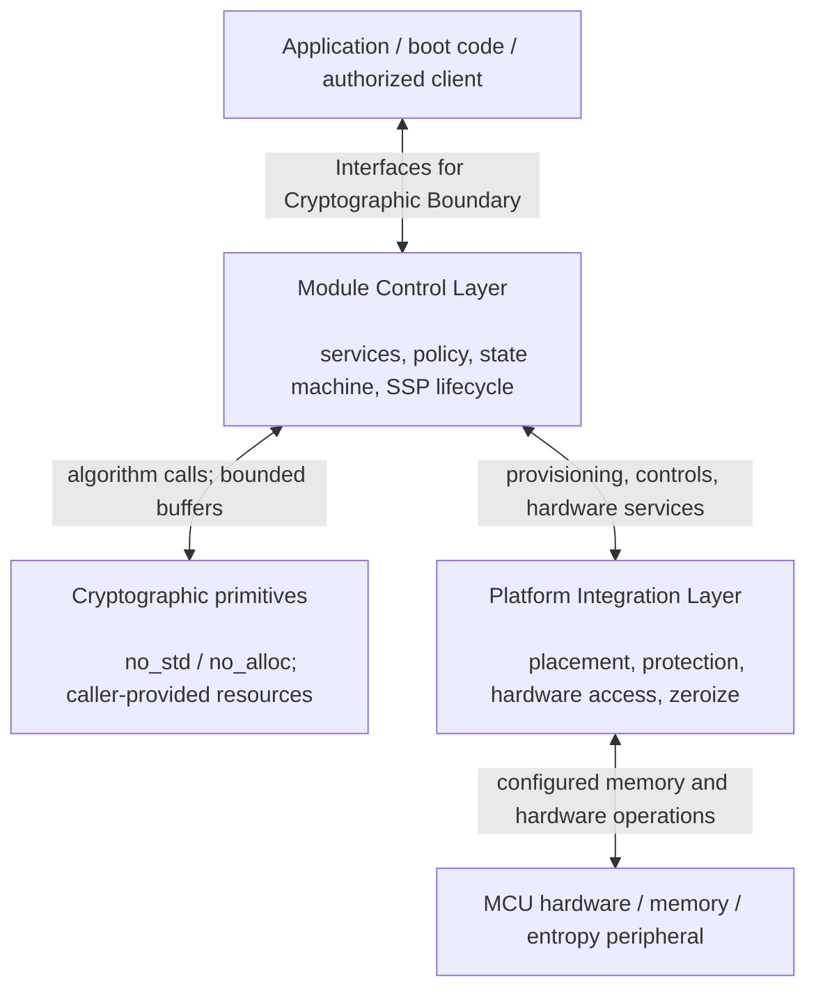

# Embedded-Crypto Architecture

**Status:** Draft for design review  
**Date:** 2026-10-19  
**Repository:** `kytheros-com/embedded-crypto`  
**Review baseline:** `main` at `6675ba7a434dbf9112c6bc0693249d05771a5f78`  
**Intended repository location:** `docs/assurance/architecture.md`

## 1. Purpose and scope

This document defines the architecture for the Kytheros `embedded-crypto` project.

The module's logical architectural roughly divides into three categories:

1. **Cryptographic primitives** implement specified algorithms, expose bounded and explicit interfaces, and supply algorithm-level evidence.
2. The **Platform Integration Layer (PIL)** implements narrowly scoped platform-dependent mechanisms used for memory placement, protection, and zeroization; hardware access; and privilege transitions.
3. The **Module Control Layer (MCL)** implements the logical boundary of the module; controls data movement, cryptographic primitive dispatch, and self tests; and maintains the security configuration.

## 2. Architectural principles

- **Separation of concerns.** A primitive implements an algorithm, not an entire module security policy. The PIL implements platform mechanisms, not cryptographic-service policy. The MCL orchestrates and enforces security policy.
- **Portable embedded core.** Production primitive paths shall be designed from the outset for `no_std` and without `alloc`, operating before an OS or fully configured MMU exists. A hosted test harness may use `std` without changing the embedded runtime contract.
- **Explicit resource ownership.** No production primitive may implicitly obtain heap storage or assume a privileged runtime service. Callers supply storage and dependencies under documented size, alignment, lifetime, and access contracts.
- **Small, reviewable trusted mechanisms.** Prefer safe Rust for portable primitives. Any unavoidable `unsafe` code shall be narrowly contained, justified, reviewed, and tested in the component requiring it; the present workspace-level `unsafe_code = "forbid"` policy must not be weakened globally without an explicit design decision.
- **No claims by association.** Correctness, memory safety, algorithm testing, module validation, side-channel behavior, and physical security are different properties, requiring separately identified evidence.
- **Traceable change control.** Architecture changes are reviewed for effects on design, requirements, interfaces, security behavior, tests, and evidence before being accepted.

## 3. Authoritative records and document relationships

The source of truth for the **CMVP planning baseline** is:

`docs/assurance/CMVP_Level_1_Software_Requirements_Matrix.xlsx`

which we often refer to simply as **The Workbook**. Its relevant worksheets include `Source Register`, `Requirements`, `Design Decisions`, `Open Questions`, `Service Contracts`, `SSP Plan`, `ISO Level 1 Index`, and `Evidence Plan`. Preserve their stable requirement, decision, question, assertion, and evidence identifiers.

- **This document** defines the logical architecture, component responsibilities, interface boundaries, and the design principles that implement recorded decisions.
- **The Workbook** records controlling sources, normative applicability, project requirements, decision status, planned services, evidence ownership and completion state.
- **`docs/assurance/project-scope.md`** defines assurance claims and the division between this project and a third-party integrating module. This architecture refines, but must not contradict, that scope.
- **Algorithm-specific design and test documents** provide per-algorithm APIs, invariants, scratch memory requirements, test coverage, and evidence; they cite Workbook identifiers rather than duplicating full normative requirements.

Any discrepancy between these documents is an error and should be reported and resolved.

## 4. Logical architecture

### 4.1 Cryptographic primitives

The cryptographic primitives are only responsible for the following:

- Conformance to a named algorithm specification, revision, supported parameter set, and defined operation; input validation and deterministic algorithm behavior as applicable.
- Explicit algorithm state and working-storage contracts, including bounded maximum storage and stack requirements for supported configurations.
- Correctness of internal state transitions, error handling, and relevant cleanup of primitive-owned temporary secrets.
- Algorithm-level development tests and evidence, including known-answer and boundary tests, and independent comparisons when available.
- Documentation of side-channel assumptions, implementation variants, and limitations of available assurance.
- An algorithm that consumes randomness accepts an **explicitly provided, documented random input**; it does not discover, generate, or request entropy.

### 4.2 Platform Integration Layer (PIL)

The Platform Integration Layer is only responsible for the following:

- Binding each supported target to fixed or statically assigned memory regions for module state, CSPs and other SSPs, plaintext, primitive workspaces, and sensitive execution stacks where required.
- Applying the selected platform's access-control mechanisms and privilege/security-domain configuration and transitions.
- Narrowly scoped access to hardware-dependent services (for example entropy-peripheral interfaces, interrupt handling, and hardware-specific reset information).
- Platform-appropriate mechanisms for externally requested zeroization, memory-region retirement, and protection of sensitive locations outside a primitive's direct control.
- The justification, containment, review, and platform testing of necessary `unsafe` Rust operations.

### 4.3 Module Control Layer (MCL)

The Module Control Layer is only responsible for the following:

- The cryptographic boundary and all operations that move data, control, and error reporting across the defined interfaces on the boundary.
- The finite state machine and enforcing allowable state transitions.
- Security logic to implement the defined security configuration.
- Coordinating between the PIL to obtain appropriate resources (e.g. protected memory, hardware-sourced entropy) and the primitives to execute the cryptographic operations.

**NOTE:** The actual cryptographic boundary and embodiment remain an explicitly open design matter (Q-001).

## 5. Interface and ownership contracts

The following contracts describe **architectural requirements**, not completed API signatures. Exact types and failure semantics are defined in component design documents and accepted through review.

| Concern | Cryptographic primitives | Platform Integration Layer | Module Control Layer |
| --- | --- | --- | --- |
| Inputs and outputs | Specify formats, lengths, alignment and overlap restrictions; reject invalid inputs with defined behavior | Make protected regions accessible only to authorized call paths | Authorize services, validate caller permissions, classify boundary-crossing data |
| Working storage | Declare bounded scratch/state needs; use only explicitly supplied or bounded local storage | Reserve and protect selected fixed regions, including sensitive stacks/scratch | Allocate resources to operations, prevent conflicting reuse and aliasing |
| Randomness | Specify exact entropy/randomness inputs required | Provide target-specific hardware source access and error/status information | Establish approved construction/qualification, reseed policy and service availability |
| SSP handling | Identify sensitive intermediates and cleanup contract; avoid uncontrolled copies | Protect, isolate and externally zeroize applicable memory regions | Own SSP inventory, usage authorization, lifetime, import/export and module zeroization policy |
| Failures | Return explicit algorithm errors; document state and output after failure | Report hardware/access/reset failures; fail closed within its defined mechanism | Translate errors into module state, output inhibition and recovery rules |
| Tests and evidence | Supply algorithm-level tests, vectors and build/implementation records | Supply target isolation, memory, cleanup and hardware configuration evidence | Initiate all POSTs, integration tests, module self-tests and provide validation evidence |

### 5.1 Memory lifetime and cleanup

1. **On PowerOn, Reset, or POST request** The MCL shall request that the PIL zeroize all temporary storage, then set the state appropriately and begin POST.
2. **Before invocation:** The MCL receives a request via a defined interface to perform an operation and possibly the associated data. The MCL determines if the operation is permitted and adjusts the finite state machine accordingly. The MCL determines required workspace sizes, obtains appropriate PIL-managed or otherwise contract-compliant memory, and enforces exclusive access and permitted lifetimes.
3. **During invocation:** The primitive accesses only memory authorized by its API contract. Primitive-local state, copies, stack usage and scratch sensitivity are documented. A mutable buffer must not be assumed non-overlapping with another buffer unless the API or language borrowing rules establish that fact.
4. **On normal completion:** the primitive performs any required cleanup of its own sensitive temporary state before reporting completion. The MCL then requests that the PIL zeroize the memory that is no longer being used. Note that reporting errors in input data, failure of signature verification, etc. are still considered normal completion.
5. **On error:** if the primitive detects an error in its own operation or triggers an error condition (e.g. illegal access) the MCL shall assume that all memory that the primitive had access to is possibly compromized and it shall request that the PIL zeroize all memory that was modifiable by the primitive. The MCL will then set the finite state machine accordingly and assert the error condition on the appropriate interface.

For sensitive memory, a source-level assignment to zero does not, by itself, prove that compiler-optimized machine code erased every copy. Implementation-specific zeroization primitives, generated-code review, target tests, interrupt/abort paths, registers, hardware buffers and stack copies are subjects for evidence. Neither safe Rust nor static allocation alone establishes complete erasure.

The adopted direction is that **portable primitives scrub their own sensitive stack/scratch where applicable; the PIL provides external, platform-dependent zeroization mechanisms; the MCL coordinates SSP lifecycle and operator-requested zeroization**. Exact contracts must be established per algorithm and target. See D-008–D-010, SSP-007/008/012, and Q-008.

### 5.2 Trust, privilege and safety boundaries

Distinguish at least four concepts:

- **Algorithm/component API boundary:** A software contract between caller and implementation.
- **Memory and privilege boundary:** Enforced by the target hardware, runtime configuration and trusted code; its extent may differ from Rust crate boundaries.
- **Module cryptographic boundary:** Established for a specific FIPS 140-3 submission, including the implementation and relevant operational environment.
- **Physical boundary/perimeter:** Depends on the actual device embodiment and applicable validation requirements.

None is implied by another. In particular, 'secure world' and 'privileged CPU mode' are distinct attributes on applicable Arm microcontrollers. The current engineering preference is small privileged configuration/ISR code with bulk cryptography unprivileged where feasible in the secure domain (D-007); exact trusted-code inclusion, hardware mappings, and evaluation remain Q-001 and related target questions.

### 5.3 Secret transfers and output policies

The MCL may receive plaintext secrets as input. However, it shall enforce the adopted policy against plaintext external export of CSPs and shall classify every external path. Public keys, signatures and ciphertexts may have different disclosure and integrity requirements. The specific ML-KEM shared-secret consumer/handle/export contract is **not yet frozen** (Q-005). The architecture does not silently authorize a raw shared-secret module service.

## 6. Random-bit generation, state, and services

Cryptographic primitives that require random input shall make that dependence explicit. The **algorithmic DRBG mechanism** can be implemented as a portable component; its **instantiation, entropy credit, hardware-source integration, reseed policy, service dispatch and failure response** are module/integration responsibilities, with hardware mechanisms provided by the PIL.

The current Workbook contains selected design directions for hardware entropy, SHA-256 Hash_DRBG, output allowance, and asynchronous prefetch (D-002, D-003, D-006). This document does **not** restate their parameter values as independent requirements. The formal RBG claim, tested device match, demand bounds, concurrency, and recovery remain open (Q-002, Q-003, Q-006, Q-008).

Likewise, password-based backup (D-011/D-012), key import/restore, authorization, and policy-level SSP output restrictions belong to the module service design, though they consume primitives. Neither a general-purpose primitive nor the PIL independently provides a CMVP-approved backup construction.

## 7. Deployment and implementation variants

The initial architectural preference is **one portable, safe Rust implementation per supported primitive**, with identified feature selections and no mandatory `std` or `alloc` runtime dependency. Distinct assembly, SIMD, accelerator, or configuration-dependent implementations are separate variants requiring explicit selection and additional evidence.

A planned embedded reference target is the **STM32U5A5ZJ** on the **NUCLEO-U5A5ZJ-Q** board (D-001). This is a development direction, **not** an accepted determination of FIPS embodiment, operational environment, physical security applicability, or entropy-source certificate reuse (Q-001, Q-003). Hosted macOS and GCP/Linux development systems are not thereby included among validated operational environments.

Generic bare-metal compilation in CI checks portability only for that tested target and configuration. It does not demonstrate correct execution, resource bounds, memory isolation, or CMVP readiness on the intended MCU.

## 8. Assurance boundaries and evidence

Evidence is developed at the level where its claim can be established:

| Evidence area | Primary owner | Integration obligation |
| --- | --- | --- |
| Algorithm conformance, API behavior and negative cases | Primitive | Identify the exact implementation/parameters, perform applicable independent testing and satisfy any additional module obligations |
| Stack/scratch bounds, error handling, local cleanup | Primitive | Confirm behavior under the selected compiler, build flags and target environment |
| Linker/memory map, isolation, privilege, DMA/debug access, hardware source conditions | PIL | Verify configuration and inclusion of all trusted mechanisms within the selected boundary |
| Approved services/modes, SSP lifecycle, zeroization service, module error state and output inhibition | MCL | Specify, implement, test and document the complete module obligations |
| Algorithm validation protocols/certificates, CAST/PCT integration and CMVP submission | Module/integrator with laboratory as appropriate | Establish exact validated implementation, operational environment and required program evidence |

Successful project tests, a `no_std` build, or reuse of an entropy-source validation do not confer FIPS 140-3 module validation. Algorithm validation and module validation are distinct. The actual claimed implementation, compiled artifact, environment, and applicable CMVP requirements must be identified and assessed separately.

The Workbook's evidence IDs (E-001–E-027) remain the master evidence planning references. Evidence ownership may be cross-layer, and completion of a library artifact is not completion of its corresponding module-level test obligation. Where a requirement combines distinct obligations, preserve its ID and create separately traceable implementation/test records rather than silently marking the entire requirement complete.
