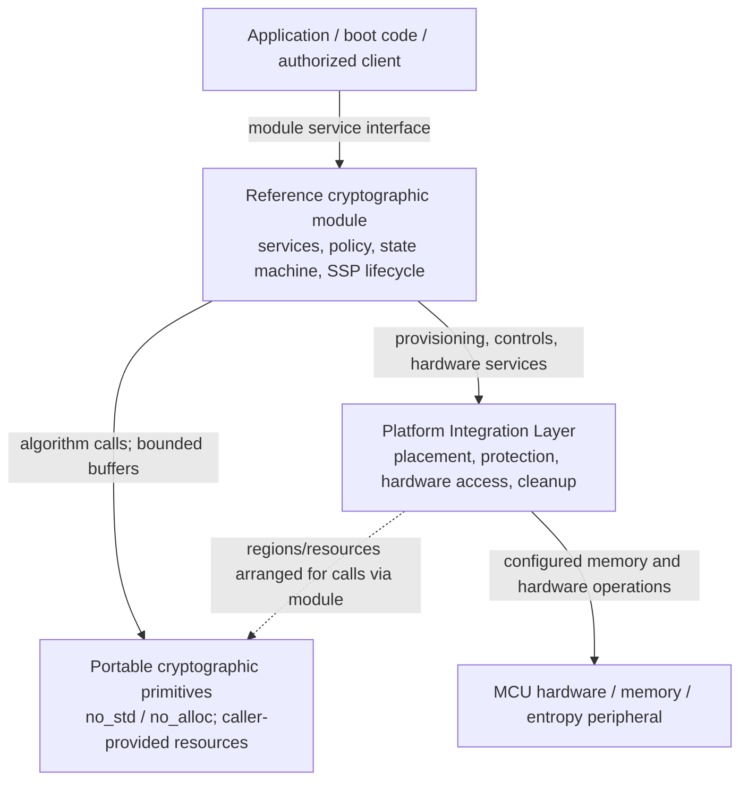

# Embedded-Crypto Architecture

**Status:** Draft for design review — not an implementation or validation claim  
**Date:** 2026-10-19  
**Repository:** `kytheros-com/embedded-crypto`  
**Review baseline:** `main` at `6675ba7a434dbf9112c6bc0693249d05771a5f78`  
**Intended repository location:** `docs/assurance/architecture.md`

## 1. Purpose and scope

This document defines the **logical architecture and allocation of engineering and assurance responsibilities** for the Kytheros `embedded-crypto` project. It is intended to prevent the scope of a reusable cryptographic primitive from silently expanding into the scope of a complete cryptographic module, while permitting an eventual reference integration to pursue FIPS 140-3 validation.

Three architectural responsibilities are distinguished:

1. **Reusable cryptographic primitives** implement specified algorithms, expose bounded and explicit interfaces, and supply algorithm-level evidence.
2. The **Platform Integration Layer (PIL)** implements narrowly scoped platform-dependent mechanisms used for memory placement and protection, hardware access, privilege transitions, and externally initiated cleanup.
3. A **reference cryptographic module** selects, composes, and governs the primitives and PIL to implement security services and module-level controls on an identified target.

These are **logical responsibilities**, not necessarily three crates, processes, privilege domains, compiled artifacts, address spaces, or FIPS 140-3 cryptographic boundaries. A particular integration must document the actual allocation and deployment of code and data.

This document does not select new algorithms, fix an unresolved CMVP classification, authorize an external secret-output service, or declare any algorithm or module validated. Detailed standards, requirements, decision statuses, and evidence plans remain in the authoritative requirements workbook (Section 3).

## 2. Architectural principles

- **Separation of concerns.** A primitive implements an algorithm, not an entire module security policy. The PIL implements platform mechanisms, not cryptographic-service policy. The module orchestrates and enforces security policy.
- **Portable embedded core.** Production primitive paths shall be designed from the outset for `no_std` and without `alloc`, operating before an OS or fully configured MMU exists. A hosted test harness may use `std` without changing the embedded runtime contract.
- **Explicit resource ownership.** No production primitive may implicitly obtain heap storage or assume a privileged runtime service. Callers supply storage and dependencies under documented size, alignment, lifetime, and access contracts.
- **Small, reviewable trusted mechanisms.** Prefer safe Rust for portable primitives. Any unavoidable `unsafe` code shall be narrowly contained, justified, reviewed, and tested in the component requiring it; the present workspace-level `unsafe_code = "forbid"` policy must not be weakened globally without an explicit design decision.
- **No claims by association.** Correctness, memory safety, algorithm testing, module validation, side-channel behavior, and physical security are different properties, requiring separately identified evidence.
- **Minimum first milestone.** SHA-2 development and assurance evidence should not be blocked by unimplemented module-wide entropy, backup, or lifecycle services that SHA-2 does not itself require.
- **Traceable change control.** Architecture changes are reviewed for effects on design, requirements, interfaces, security behavior, tests, and evidence before being accepted.

## 3. Authoritative records and document relationships

The source of truth for the **CMVP planning baseline** is:

`docs/assurance/CMVP_Level_1_Software_Requirements_Matrix.xlsx`

Its relevant worksheets include `Source Register`, `Requirements`, `Design Decisions`, `Open Questions`, `Service Contracts`, `SSP Plan`, `ISO Level 1 Index`, and `Evidence Plan`. Preserve their stable requirement, decision, question, assertion, and evidence identifiers.

- **This document** defines the logical architecture, component responsibilities, interface boundaries, and the design principles that implement recorded decisions.
- **The workbook** records controlling sources, normative applicability, project requirements, decision status, planned services, evidence ownership and completion state. It is not proof of implementation or validation.
- **`docs/assurance/project-scope.md`** defines assurance claims and the division between this project and a third-party integrating module. This architecture refines, but must not contradict, that scope.
- **Algorithm-specific design and test documents** provide per-algorithm APIs, invariants, scratch requirements, test coverage, and evidence; they cite workbook identifiers rather than duplicating full normative requirements.

There shall be **one maintained standards register**. The proposed removal of `docs/assurance/standards-register.md` is a separate change, gated on migration of any unique source metadata, provenance, and monitoring rules into the workbook and repair of references to that file. Do not silently delete those records.

If the workbook and this architecture disagree, record the discrepancy and resolve it through a reviewed decision. Neither document silently overrides the other; controlling standards and applicable CMVP guidance take precedence over project summaries.

## 4. Logical architecture

**Arrows indicate responsibility and resource flow, not an implementation requirement for direct calls between components.** In particular, a portable primitive should not invoke the PIL through a hidden global dependency. The module (or an explicitly documented integrating caller) obtains PIL-managed resources and passes ordinary, suitably constrained Rust arguments into the primitive.

The reusable primitive layer can be used by other integrators without adopting the Kytheros reference module or PIL, provided those integrators satisfy the primitive's contracts.

### 4.1 Reusable cryptographic primitives

**Own:**

- Conformance to a named algorithm specification, revision, supported parameter set, and defined operation; input validation and deterministic algorithm behavior as applicable.
- Explicit algorithm state and working-storage contracts, including bounded maximum storage and stack requirements for supported configurations.
- Correctness of internal state transitions, error handling, and relevant cleanup of primitive-owned temporary secrets.
- Algorithm-level development tests and evidence, including known-answer and boundary tests, and independent comparisons when available.
- Documentation of side-channel assumptions, implementation variants, and limitations of available assurance.

**Do not own:** module role authentication, the FIPS approved-service indicator, module-wide self-test scheduling or error state, hardware entropy qualification, external SSP entry/output policy, platform privilege and DMA/debug controls, secure boot, key-backup service policy, or CMVP submission.

An algorithm that consumes randomness accepts an **explicitly provided, documented randomness interface or input**; it does not discover or silently seed its own hardware source. The precise randomness interface and per-operation contract belong to the applicable algorithm design. SHA-2 itself requires no randomness for ordinary hashing.

### 4.2 Platform Integration Layer (PIL)

**Own:**

- Binding each supported target to fixed or statically assigned memory regions for module state, CSPs and other SSPs, plaintext, primitive workspaces, and sensitive execution stacks where required.
- Applying the selected platform's access-control mechanisms and privilege/security-domain configuration.
- Narrowly scoped access to hardware-dependent services (for example entropy-peripheral interfaces, interrupt handling, hardware-specific reset information, and possible cryptographic accelerators when explicitly selected).
- Platform-appropriate mechanisms for externally requested zeroization, memory-region retirement, and protection of sensitive locations outside a primitive's direct control.
- The justification, containment, review, and platform testing of necessary unsafe operations.

**Do not own:** selection of approved module services, policy for exporting CSPs, whether an algorithm operation is authorized, algorithm semantics, a module-wide self-test pass/fail decision, or assertion of a CMVP-approved operational environment.

Static placement is **not** itself proof of protection or zeroization; MPU/TrustZone/GTZC, nonsecure accesses, DMA, debugger access, reset retention, registers, and copies require target-specific analysis and tests. An address or pointer is not automatically an authorization capability.

### 4.3 Reference cryptographic module

**Own:**

- A declared set of services, authorized roles, service inputs/outputs, security mode(s), external interfaces, and key/SSP usage policies.
- The logical module state machine, service gating, error response, reset recovery, and required self-test orchestration.
- Selection and integration of primitives, the PIL, entropy sources, deterministic RBGs, key-management mechanisms, and possible backup/restore services.
- Module-level classification, authorization, lifecycle, protection, entry, output, and zeroization of SSPs (including public SSPs where applicable).
- The security boundary, version/configuration, operational environment, build identity, target measurements, integration evidence, and eventual laboratory engagement.

**Do not assume:** that the logical module equals a particular Cargo crate, executable, TrustZone security domain, physical board, or validated cryptographic boundary. Its actual cryptographic boundary and embodiment remain an explicitly open design matter (Q-001).

A third-party integrating module assumes these responsibilities for its own integration; use of Kytheros primitives does not transfer a Kytheros validation claim to that product.

## 5. Interface and ownership contracts

The following contracts describe **architectural requirements**, not completed API signatures. Exact types and failure semantics are defined in component design documents and accepted through review.

| Concern | Primitive obligation | PIL obligation | Reference-module obligation |
| --- | --- | --- | --- |
| Inputs and outputs | Specify formats, lengths, alignment and overlap restrictions; reject invalid inputs with defined behavior | Make protected regions accessible only to authorized call paths | Authorize services, validate caller permissions, classify crossing-boundary data |
| Working storage | Declare bounded scratch/state needs; use only explicitly supplied or bounded local storage | Reserve and protect selected fixed regions, including sensitive stacks/scratch | Allocate resources to operations, prevent conflicting reuse and aliasing |
| Randomness | Specify exact entropy/randomness inputs or a caller-provided RNG contract where needed | Provide target-specific hardware source access and error/status information | Establish approved construction/qualification, reseed policy and service availability |
| SSP handling | Identify sensitive intermediates and cleanup contract; avoid uncontrolled copies | Protect, isolate and externally zeroize applicable memory regions | Own SSP inventory, usage authorization, lifetime, import/export and module zeroization policy |
| Failures | Return explicit algorithm errors; document state and output after failure | Report hardware/access/reset failures; fail closed within its defined mechanism | Translate errors into module state, output inhibition and recovery rules |
| Tests and evidence | Supply algorithm-level tests, vectors and build/implementation records | Supply target isolation, memory, cleanup and hardware configuration evidence | Produce integration tests, module self-tests and validation evidence |

### 5.1 Memory lifetime and cleanup

1. **Before invocation:** the integrating caller determines required workspace sizes, obtains appropriate PIL-managed or otherwise contract-compliant memory, and enforces exclusive access and permitted lifetimes.
2. **During invocation:** the primitive accesses only memory authorized by its API contract. Primitive-local state, copies, stack usage and scratch sensitivity are documented. A mutable buffer must not be assumed non-overlapping with another buffer unless the API or language borrowing rules establish that fact.
3. **On normal completion:** the primitive performs any required cleanup of its own sensitive temporary state before reporting completion. The caller retains responsibility for the lifetime and cleanup of supplied buffers and outputs unless ownership was explicitly transferred.
4. **On reported failure:** the primitive documents whether outputs were written, which state remains valid, and which cleanup was completed. The module treats any externally visible partial output and SSP exposure according to its policy.
5. **On cancellation, reset, fault, or interrupted execution:** ordinary return-path cleanup cannot be presumed to have run. The PIL and reference module jointly define what can be wiped or rendered inaccessible, how restart initializes protected regions, and when sensitive state is no longer usable (Q-008).

For sensitive memory, a source-level assignment to zero does not, by itself, prove that compiler-optimized machine code erased every copy. Implementation-specific zeroization primitives, generated-code review, target tests, interrupt/abort paths, registers, hardware buffers and stack copies are subjects for evidence. Neither safe Rust nor static allocation alone establishes complete erasure.

The adopted direction is that **portable primitives scrub their own sensitive stack/scratch where applicable; the PIL provides external, platform-dependent zeroization mechanisms; the module coordinates SSP lifecycle and operator-requested zeroization**. Exact contracts must be established per algorithm and target. See D-008–D-010, SSP-007/008/012, and Q-008.

### 5.2 Trust, privilege and safety boundaries

Distinguish at least four concepts:

- **Algorithm/component API boundary:** A software contract between caller and implementation.
- **Memory and privilege boundary:** Enforced by the target hardware, runtime configuration and trusted code; its extent may differ from Rust crate boundaries.
- **Module cryptographic boundary:** Established for a specific FIPS 140-3 submission, including the implementation and relevant operational environment.
- **Physical boundary/perimeter:** Depends on the actual device embodiment and applicable validation requirements.

None is implied by another. In particular, 'secure world' and 'privileged CPU mode' are distinct attributes on applicable Arm microcontrollers. The current engineering preference is small privileged configuration/ISR code with bulk cryptography unprivileged where feasible in the secure domain (D-007); exact trusted-code inclusion, hardware mappings, and evaluation remain Q-001 and related target questions.

### 5.3 Secret transfers and output policies

A reusable primitive may need to produce a secret result into a caller-provided protected buffer. Such an **internal component transfer** is not automatically an authorized plaintext secret **output across the reference module's external cryptographic boundary**.

The module shall enforce its adopted policy against plaintext external export of CSPs and shall classify every external path. Public keys, signatures and ciphertexts may have different disclosure and integrity requirements. The specific ML-KEM shared-secret consumer/handle/export contract is **not yet frozen** (Q-005). The architecture does not silently authorize a raw shared-secret module service.

## 6. Random-bit generation, state, and services

Cryptographic primitives that require random input shall make that dependence explicit. The **algorithmic DRBG mechanism** can be implemented as a portable component; its **instantiation, entropy credit, hardware-source integration, reseed policy, service dispatch and failure response** are module/integration responsibilities, with hardware mechanisms provided by the PIL.

The current workbook contains selected design directions for hardware entropy, SHA-256 Hash_DRBG, output allowance, and asynchronous prefetch (D-002, D-003, D-006). This document does **not** restate their parameter values as independent requirements. The formal RBG claim, tested device match, demand bounds, concurrency, and recovery remain open (Q-002, Q-003, Q-006, Q-008).

Likewise, password-based backup (D-011/D-012), key import/restore, authorization, and policy-level SSP output restrictions belong to the module service design, though they consume portable primitives. Neither a general-purpose primitive nor the PIL independently provides a CMVP-approved backup construction.

## 7. Deployment and implementation variants

The initial architectural preference is **one portable, safe Rust implementation per supported primitive**, with identified feature selections and no mandatory `std` or `alloc` runtime dependency. Distinct assembly, SIMD, accelerator, or configuration-dependent implementations are separate variants requiring explicit selection and additional evidence.

A planned embedded reference target is the **STM32U5A5ZJ** on the **NUCLEO-U5A5ZJ-Q** board (D-001). This is a development direction, **not** an accepted determination of FIPS embodiment, operational environment, physical security applicability, or entropy-source certificate reuse (Q-001, Q-003). Hosted macOS and GCP/Linux development systems are not thereby included among validated operational environments.

Generic bare-metal compilation in CI checks portability only for that tested target and configuration. It does not demonstrate correct execution, resource bounds, memory isolation, or CMVP readiness on the intended MCU.

## 8. Assurance boundaries and evidence

Evidence is developed at the level where its claim can be established:

| Evidence area | Primary owner | Integration obligation |
| --- | --- | --- |
| Algorithm conformance, API behavior and negative cases | Primitive | Identify the exact implementation/parameters, perform applicable independent testing and satisfy any additional module obligations |
| Stack/scratch bounds, error handling, local cleanup | Primitive | Confirm behavior under the selected compiler, build flags and target environment |
| Linker/memory map, isolation, privilege, DMA/debug access, hardware source conditions | PIL | Verify configuration and inclusion of all trusted mechanisms within the selected boundary |
| Approved services/modes, SSP lifecycle, zeroization service, module error state and output inhibition | Reference module | Specify, implement, test and document the complete module obligations |
| Algorithm validation protocols/certificates, CAST/PCT integration and CMVP submission | Module/integrator with laboratory as appropriate | Establish exact validated implementation, operational environment and required program evidence |

Successful project tests, a `no_std` build, or reuse of an entropy-source validation do not confer FIPS 140-3 module validation. Algorithm validation and module validation are distinct. The actual claimed implementation, compiled artifact, environment, and applicable CMVP requirements must be identified and assessed separately.

The workbook's evidence IDs (E-001–E-027) remain the master evidence planning references. Evidence ownership may be cross-layer, and completion of a library artifact is not completion of its corresponding module-level test obligation. Where a requirement combines distinct obligations, preserve its ID and create separately traceable implementation/test records rather than silently marking the entire requirement complete.

## 9. Initial implementation milestone

**First implementation focus: SHA-2** in `crates/kytheros_sha2`, using the current workspace as the starting point.

The SHA-2 milestone shall establish, to the extent applicable:

- A frozen list of implemented variants and exposed APIs, with their governing specification identified in the workbook (see Q-007).
- Explicit incremental/finalization and invalid-input behavior, with bounded state and no mandatory `std` or `alloc` use.
- Documented input/output, alignment, workspace, overlap, copy and cleanup contracts.
- Known-answer, empty-input, padding-boundary, incremental, maximal-length/overflow-handling (as feasible), and negative tests relevant to the chosen APIs.
- Repeatable compiler/configuration records, compilation checks for selected embedded configurations, and initial resource measurements once a representative target exists.
- Honest claims limited to what the implemented code, tests, and reviews actually establish.

This milestone does **not** require implementation of entropy hardware, Hash_DRBG, key backup, a full module finite-state machine, or a completed CMVP submission package before its algorithmic work can be evaluated. Subsequent module integration must satisfy its own requirements.

## 10. Unresolved design gates

The following decisions remain **open**, notwithstanding the agreed three-layer division:

| Gate | Issue | Workbook references |
| --- | --- | --- |
| Actual cryptographic/privilege boundaries and OE classification | Hardware/firmware embodiment, included trusted components, physical applicability | Q-001; D-001, D-007 |
| RBG approval, entropy-source match and recovery | Construction/credit, purchased device and conditions, demand bounds and fault behavior | Q-002, Q-003, Q-006, Q-008 |
| External ML-KEM shared-secret contract | Handle/consumer interface versus approved protected output, including validation implications | Q-005; D-010 |
| Stored-key backup | Protection format, SP 800-132 selection, password/input contract and strength justification | Q-004, Q-009, Q-010; D-011/D-012 |
| Algorithm variants and test coverage | Exposed hash APIs/acceleration, PQC key checks, seed restoration | Q-007, Q-011 |

These are **not resolved by this architecture document**. The workbook governs their current decision statuses. No implementation may turn an open gate into an unstated assumption.

## 11. Configuration management and review

- Architectural changes shall be proposed and reviewed on a branch before merge to protected `main`.
- Requirement, decision, source, question and evidence identifiers shall remain stable; add cross-references rather than duplicate authoritative tables.
- Each change shall identify affected layers, public/internal contracts, threat and leakage assumptions, target configurations, tests, and evidence.
- If a decision changes normative applicability or the future validation boundary, update the corresponding workbook entries and obtain independent/CSTL assessment when applicable.
- Changes to supported parameters, memory ownership, secret output, zeroization, randomness, hardware variants, or module services require explicit security-impact review.
- Implementation and evidence statuses must never be inferred merely from the existence of a design document, CI success, or a completed planning worksheet.

## 12. Design-decision and requirement cross-reference

This document gives architectural context to the workbook's decisions; it does not replace their complete text:

| Area | Relevant decision IDs | Representative requirement families |
| --- | --- | --- |
| Embedded target and integration boundary | D-001, D-007 | SPEC, OE, PHY, ARCH |
| Entropy and RBG services | D-002, D-003, D-006 | RBG, SSP, TEST |
| Algorithm scope and portability | D-004, D-005 | ALG, TEST, SW |
| Protected memory and reset | D-008, D-009 | ARCH, SSP, LC |
| Secret/public output and backup | D-010, D-011, D-012, D-013 | IF, SSP, BKP, ROLE |
| Assurance and change control | D-014 | PROC, GEN, LC |

**Review outcome sought:** acceptance of the three-layer logical architecture and ownership principles, not automatic approval of the open module-specific choices enumerated in Section 10.
