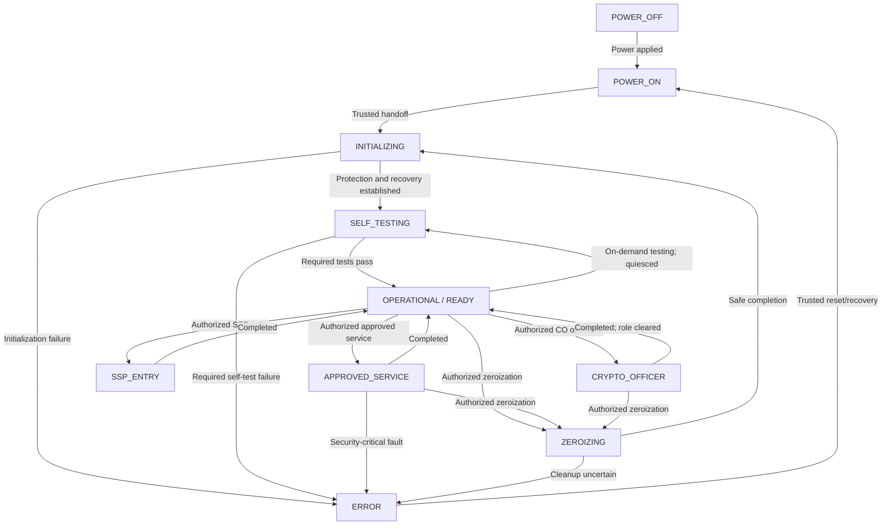
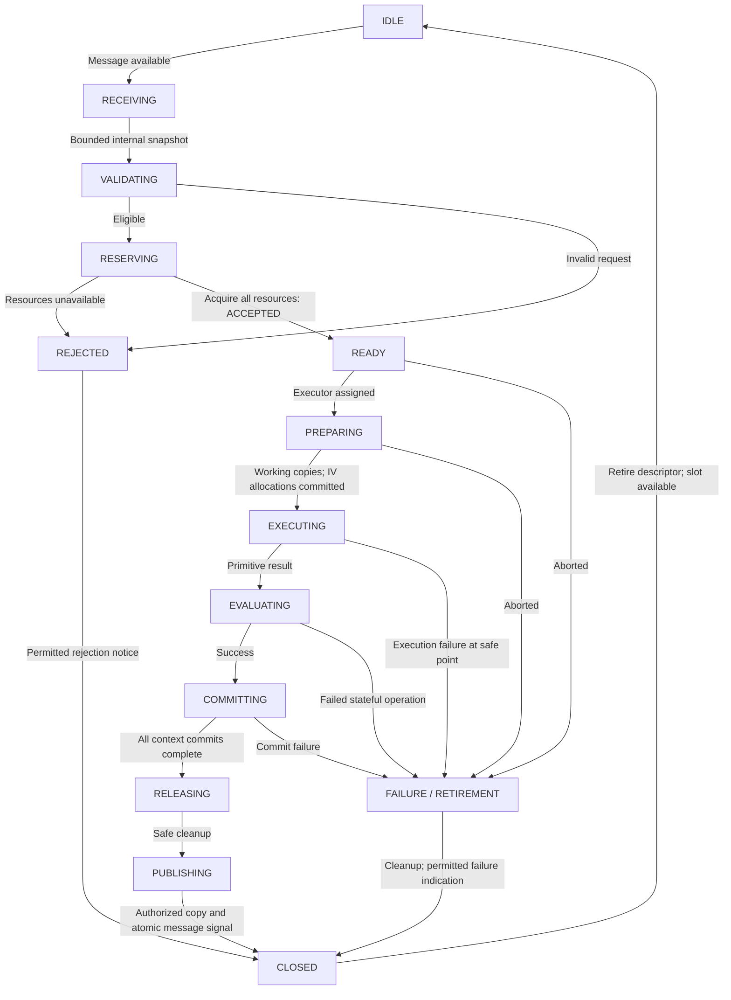
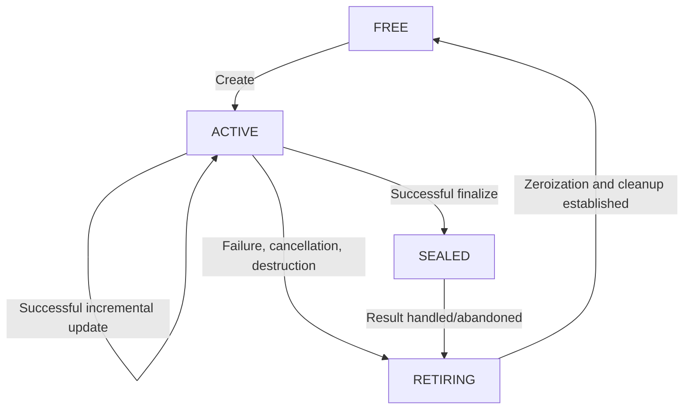

# MCL Finite-State Architecture — Agreed Design Baseline

**Status:** Conceptual design agreed; exhaustive transition/evidence mapping and implementation pending  
**Date:** 2026-10-23  
**Branch:** `design-requirements-audit/2026-10-19`  
**Scope:** Reference MCL/PIL integration, not an implemented or validated FIPS module

## 1. Authority and model

This document defines four coordinated **logical** state machines:
`FSM-MOD` (module), `FSM-OP` (individual operation), `FSM-CTX`
(persistent mutable context) and `FSM-KEY` (protected key record).
A diagram state need not be a literal enum in implementation. Guards,
events and behavior must remain traceable and testable.

Normative research is in
[the FSM requirements notes](../assurance/fsm-requirements-notes.md).
The [CMVP workbook](../assurance/CMVP_Level_1_Software_Requirements_Matrix.xlsx)
remains authoritative for source applicability, requirement/decision IDs,
services, questions and evidence status. Labels here are **local design
notation**, not additional workbook IDs or a claim of CMVP compliance.
The formal cryptographic boundary Q-001, reset/fault realization Q-008,
specific role/service policy and memory layout remain open.

Terms:
- **Authoritative context:** MCL-owned protected state retained between
  service calls, inaccessible to cryptographic primitives.
- **Working copy:** isolated, bounded storage accessible to one invoked
  primitive according to its PIL-enforced capability assignment.
- **Accepted operation:** internally copied and validated request for
  which all participating contexts/resources have been acquired.
  Message available and message received are not acceptance.
- **Context group:** bounded, predefined fixed-membership composition,
  never an arbitrary dependency graph.
- **Published:** completed outward message signaled through an atomic
  mailbox synchronization operation. Physical exposure of *authorized*
  bytes can begin during the preceding copy.

Only the MCL can modify authoritative context, key and IV-allocation
records. A successful primitive return validates the resulting working
state **under its specified contract**; the MCL does not independently
recompute its mathematical result. Operation lifecycle and context
lifecycle are separate from key lifecycle and the module's policy.

The initial implementation serializes primitive execution (one active
primitive at a time), yet uses per-operation descriptors, exclusive
context ownership and separable key-allocation synchronization so future
concurrent execution does not require a different security model.

## 2. FSM-MOD — module lifecycle and service gates

Conceptual module states: `POWER_OFF`, `POWER_ON`, `INITIALIZING`,
`SELF_TESTING`, `OPERATIONAL`, `ZEROIZING` and `ERROR`.
The `OPERATIONAL` hierarchy identifies `READY`,
`CRYPTO_OFFICER`, `SSP_ENTRY`, `APPROVED_SERVICE` and
`USER` if a User role is implemented, or equivalent explicit
role/service substates. Future simultaneous operations cannot be
modeled as mutually exclusive single global service activity; the
module and individual operation/role descriptions are hierarchical.



The diagram omits common power-loss/reset and security-fault arrows for
legibility; the complete transition table must include them. `ERROR`
is **not** synonymous with destroying every SSP. A trusted reset
re-enters initialization, sanitizes/revalidates retained state and
performs required self-tests before permitting services. If trusted
recovery is impossible, services remain fail-secure. No direct jump
from `ERROR` to normal operations is permitted.

| From | Event/guard | To | MCL/PIL action |
| --- | --- | --- | --- |
| `POWER_OFF` | Power applied | `POWER_ON` | PIL reset entry |
| `POWER_ON` | Trustworthy protection and handoff available | `INITIALIZING` | Inhibit services, establish isolation |
| `INITIALIZING` | Retained-state checks, volatile cleanup, zeroization recovery established | `SELF_TESTING` | Initiate pre-operational tests |
| `SELF_TESTING` | All required tests pass | `OPERATIONAL/READY` | Permit eligible requests |
| `SELF_TESTING` | Required test fails | `ERROR` | Inhibit services and prohibited output; permitted error indicator |
| `OPERATIONAL/READY` | Authorized service / role request | Appropriate service substate | Delegate individual operation to FSM-OP |
| Service substate | Defined completion/rejection/cancellation | `OPERATIONAL/READY` | Complete permitted status, role clearing and cleanup |
| Operational state | Authorized zeroization | `ZEROIZING` | Quiesce conflicts; zeroize scoped SSPs |
| `ZEROIZING` | Safely finished | `INITIALIZING` | Reinitialize/test before services |
| `ZEROIZING` | Cleanup uncertain or impossible | `ERROR` | Prevent reuse |
| `OPERATIONAL/READY` | On-demand test after quiescence | `SELF_TESTING` | Inhibit ordinary services during tests |
| Any powered state | Unexpected security-critical fault | `ERROR` or fail-secure reset | Fault-scope policy |
| `ERROR` | Trusted recovery authorized | `POWER_ON` | Repeat boot procedure |
| Any powered state | Power loss/reset | `POWER_OFF` / reset startup | No volatile context survives |

Required conditional algorithm self-tests may be service-specific guards
rather than module-wide `SELF_TESTING` transitions. Failed required tests
invoke the specified error policy. Exact Crypto Officer/User
authentication, role-switch rules (including no direct transition
to Crypto Officer from another role), loading and status-indicator
behavior await the role/service matrix.

## 3. FSM-OP — accepted operation lifecycle



The MCL copies untrusted input into protected storage; only the
**internal snapshot** governs validation and dispatch. An adversarial
host can race that copy, so the snapshot is treated as arbitrary input.
The MCL rejects malformed, oversized or unauthorized requests and
resource shortages **before acceptance**, without invalidating an
otherwise valid existing context. Acceptance requires exclusive
acquisition of all participating mutable contexts and group resources.
It commits to controlled execution/termination, **not** guaranteed
success. A `CLOSED → IDLE` transition returns an *operation slot*
to availability, not necessarily the entire module to idleness.

For encryption requiring a new IV, the security ordering is:

```text
accept -> irrevocably allocate and commit spent IV/usage state
  -> prepare isolated working copies -> execute primitives
  -> evaluate required success and authentication conditions
  -> MCL-only commit of all authoritative context updates
  -> cleanup/release execution resources
  -> authorize disclosure of the *entire* result
  -> copy to outward mailbox -> atomic semaphore publication -> close
```

An accepted failure/cancellation after IV allocation never reclaims
that IV or its counted invocation. The primitive has no ability to
write MCL contexts, key metadata, semaphores or external mailboxes.
The PIL enforces this capability restriction independently of
primitive cooperation.

An MCL commit of several contexts keeps the entire acquired set
unavailable to other operations until the commit completes.
A partial or uncertain commit invalidates all participating mutable
contexts; **there is no rollback**. Volatile contexts are never
recovered following module reset.

An authorized result may become partly *physically readable* during
mailbox copying, before the final semaphore signal. That is permitted
only because the **complete result** was already authorized before
the first outward byte. Partial early reads carry no valid complete
message semantics; a failed copy cannot revoke already exposed bytes.
Protected output staging survives until publication or abandonment.

### 3.1 Operation outcomes and exceptional actions

| Event/class | Outcome and actions |
| --- | --- |
| Rejection before acceptance | `REJECTED`; preserve existing valid contexts |
| Expected GCM tag mismatch | Normal negative outcome; retire running GCM context and dependent fixed-group contexts, destroy provisional plaintext; **preserve valid AES key and IV metadata** |
| Invalid signature | Normal service answer; context disposition explicitly set by service contract |
| Failed accepted stateful operation | Retire all acquired mutable contexts and dependent provisional group members, without rollback |
| Authorized cancellation | Pending until safe interruption point; then retire participating mutable contexts and provisional results; no IV/usage refund |
| Unexpected primitive internal/memory fault | Module `ERROR` handling; wipe all memory writable by the primitive, from independent trusted PIL mapping |
| Interrupted/uncertain context commit | Entire participating set retired; no partially committed context reused |
| Failed required cleanup | Prevent resource reuse and escalate to module error/recovery |
| Interrupted outward copy | Disallow further prohibited writes, record incomplete message; prior authorized prefix cannot be recalled |

Cancellation is untrusted control input. It cannot interrupt the
durable IV reservation, context commit or other indivisible
security-critical update. The MCL records cancellation pending and
executes it at a safe point. Already published results cannot be
retroactively canceled; subsequent context destruction is a separate
authorized service.

## 4. FSM-CTX — protected operation-context lifecycle

There is a statically bounded context pool. Lifecycle and exclusive
ownership are independent: an `ACTIVE` context may be acquired by
one accepted operation but never by two simultaneously.



| State | Meaning |
| --- | --- |
| `FREE` | Slot sanitized, available and old handles unusable |
| `ACTIVE` | Authoritative cryptographic state valid for permitted future operations |
| `SEALED` | Finalized; no further updates; pending result may await completion |
| `RETIRING` | Transient **one-way** state; no acquisitions; destruction/quiescence in progress |

`RETIRING` cannot return to `ACTIVE` or `SEALED`; its only normal
exit is `FREE` *after* safe cleanup. Handles are invalidated before
erasure and never confer authorization by themselves. Generation/validity
control prevents use-after-slot-reuse and stale handles across reset.
If retirement is interrupted, storage remains unusable until reset
initialization or trusted cleanup completes. Every volatile context
is destroyed/reinitialized on any module reset.

A composition is **only** an enumerated, bounded, fixed-membership
group with a defined common retirement policy and any necessary
provisional authentication condition. No arbitrary dependency graph
or user-programmable composition is supported. On group failure,
the MCL makes all affected group members unusable before zeroization.
An otherwise independent context is not invalidated by an expected
GCM authentication failure.

### 4.1 Bounded authenticated decryption

AES-GCM authentication validates a complete message, not an
incrementally authenticated prefix. For a bounded whole-message
decryption, provisional plaintext stays in protected internal
staging until the **final tag succeeds**, at which point the MCL may
authorize publication after context commit. On tag mismatch the
plaintext, GCM state and dependent group are destroyed, while the
valid AES key survives.

The MCL rejects a proposed request or incremental update *before
acceptance* when cumulative plaintext would exceed the configured
`L_max`, overflow length arithmetic, or exhaust protected staging.
This pre-acceptance rejection preserves an existing valid context.
The exact `L_max` will be chosen after RAM/stack/pool budgeting;
bounded TLS 1.3 fragments offer context but are not a selected limit.
**No Kytheros-specific record streaming protocol** is part of this
module. Higher layers own framing; the module's authentication
contract remains whole-message.

## 5. FSM-KEY — persistent key lifecycle and IV assurance

| State | Encryption | Decryption | Meaning |
| --- | --- | --- | --- |
| `UNVERIFIED` | No | No | Creation/import/restore or reset validation in progress |
| `ENCRYPT_ENABLED` | Only if policy authorizes | Only if policy authorizes | Key record and relevant IV assurance established |
| `DECRYPT_ONLY` | **No** | Only if independently authorized | Key trustworthy for decrypt, IV encryption assurance absent or revoked |
| `INVALID` | No | No | Essential key material/identity/authorization untrustworthy; retire |
| `DESTROYED` | No | No | Key irrevocably retired/zeroized |

The transition from `ENCRYPT_ENABLED` to `DECRYPT_ONLY` is
**irreversible for the same key material**. Restore/new metadata
cannot re-enable encryption. A new independently valid encryption
key is required. When key integrity or decryption authorization
is also uncertain, the key is `INVALID`, **not** `DECRYPT_ONLY`.
Key identity, material, permitted uses, provenance, IV strategy,
invocation state/limits, integrity and anti-rollback protections
form one protected record.

Two key-bound AES-GCM IV strategies are supported:

- **Deterministic:** allocate the next unique IV/counter range and
  durably commit its consumption before the corresponding primitive
  can encrypt. Reset/failure/cancellation never reclaims a spent
  IV, including unused reserved values.
- **RBG-based:** use the MCL-managed approved RBG/DRBG under the
  selected SP 800-38D construction, meeting reseed, reset and
  applicable aggregate per-key limits. For a 96-bit random
  construction, SP 800-38D §8.3 limits authenticated-encryption
  invocations to `2^32` per key across relevant instances,
  **not per context/device**. Do not mix deterministic and
  RBG IV constructions for the same IV length under a key.

The host cannot simply dictate IVs under unrestricted encryption
services. The MCL owns allocation and usage accounting, which
are **not** part of operation-context rollback/commit. RBG
temporary unavailability can reject/defer a request without
downgrading a trustworthy key; loss of IV assurance requires
irreversible encryption prohibition. A previously used restored
key with unknown IV history may be decryption-only. Fresh
independently derived key material can enable encryption after
proper validation and IV strategy initialization.


### 5.1 MACsec and MACsec-XPN protocol-bound IV profiles

**Design accommodation, not an approved-service claim:** Kytheros shall
allow distinct MACsec GCM-AES and MACsec GCM-AES-XPN deterministic-IV
profiles in future service design without adding a MACsec protocol
engine or permitting unrestricted externally chosen encryption IVs.
Ordinary deterministic and approved RBG-based GCM services remain
separate. The selected IV construction is fixed by protected key/
transmit-association metadata, not chosen freely on each request.

| Profile | 96-bit AES-GCM IV | Transmit PN tracked by MCL |
| --- | --- | --- |
| MACsec GCM-AES-128/256 | `SCI[64] || PN[32]` | Full 32-bit PN |
| MACsec GCM-AES-XPN-128/256 | `(SSCI[32] || XPN[64]) XOR Salt[96]` | Full 64-bit XPN (only low 32 bits in on-wire SecTAG) |

SAK means Security Association Key; SCI is Secure Channel Identifier,
SSCI is Short SCI, and the XPN salt is 96 bits. IEEE 802.1AE and its
applicable amendments define actual frame processing and the
corresponding association-parameter assignment.

For each encryption-capable key and transmitting association, the
MCL needs protected, integrity-checked and anti-rollback-bound
metadata: SAK/key identity, permitted use, cipher suite/profile,
authorized association/transmitter identity (SCI, and SSCI as
applicable), XPN salt, **full-width highest allocated PN or
equivalent next-unspent bound**, exhaustion policy and key/association
lifecycle. Reassignment of SCI/SSCI/salt, profile or restored
allocation metadata must not reintroduce a previously used full IV.
Distinct transmitters sharing the same SAK require **global
key/IV uniqueness across their associations**, not merely
individual local counters. The initial profile should constrain
ownership to one authorized transmitter per installed association.

The external MACsec integrator may **propose** a PN under a specific
authorized association service, or the MCL may allocate the next PN.
In either case, before primitive encryption the MCL checks the full
PN against protected association identity and bounds, requires it
to be **strictly greater than every previously allocated PN for
that key/association**, and durably marks the chosen PN and skipped
values spent. A cancel, failure or reset never refunds PN values.
Reject duplicate, lower, overflowing, exhausted or uncertain PNs.
XPN comparisons use the **64-bit** value, not the truncated SecTAG
field. The integrating peer must construct its transmitted SecTAG
from the exact accepted association and PN. Monotonic-PN validation
alone is insufficient if other senders can use the same SAK and
IV namespace or restore stale association information.

On **decryption**, a MACsec-supplied 96-bit IV may be accepted as
untrusted input to the bounded whole-message authenticated-decryption
service. Encryption-IV uniqueness restrictions do not require
strictly increasing receive-side PNs. MACsec frame parsing, XPN
high-bit reconstruction, receive replay windows and key exchange
belong to the external protocol implementation unless separately
designed as services; successful GCM authentication alone does not
provide replay prevention.

**CMVP approval conditions are not optional.** FIPS 140-3 IG §C.H
Scenario 1(c) (2026-08-19) explicitly recognizes MACsec
GCM-AES-128/256 and XPN-128/256 but treats IV generation and management
as **distributed** among Peer, Authenticator and optional
Authentication Server modules. The final Security Policy and
validation evidence must identify every module's MACsec role,
the collaboration with other validated components, and the IV
generation and restore procedure. **Scenario 3a** requires an
acceptable post-power-loss IV restoration policy (such as securely
resuming the counter or establishing a new key), not an assumption
that a host-supplied PN is trustworthy. IG §C.H Additional
Comment 8 **prohibits statically configured pre-shared SAKs
in approved mode**. The module cannot claim MACsec approval just
because its local PN increases. These requirements are pending
boundary/service design, workbook reconciliation and CSTL review.

Sources: [CMVP FIPS 140-3 IG, §C.H](https://csrc.nist.gov/csrc/media/Projects/cryptographic-module-validation-program/documents/fips%20140-3/FIPS%20140-3%20IG.pdf)
(latest update verified 2026-10-23: 2026-08-19) and
[IEEE 802.1AE standards](https://1.ieee802.org/security/802-1ae/).

## 6. Disclosure and physical output inhibition

The MCL verifies success, completion of **all required context
commits**, authorization/classification of the **entire result**,
and the current module-state output policy **before copying any
result bytes to physically readable outbound mailbox memory**.
This includes successful GCM tag verification for plaintext and
successful resolution of provisional composition conditions.

The host may read mailbox bytes regardless of semaphore ownership.
The semaphore serves **only cooperative synchronization**: the
atomic transition says a complete result is available, not that
pre-signal bytes were confidential. Early reads may show an
authorized partial prefix but are not valid completed messages.
Never stage an unauthorized SSP or provisional plaintext in
outward mailboxes.

The PIL/interface design must establish actual data/control-output
inhibition in error, zeroization, pre-operational tests, manual SSP
entry and loading as applicable under ISO/CMVP requirements.
**The output-inhibition guard covers routine SSP zeroization in
`RELEASING` or `RETIRING`, not only global `ZEROIZING`.** Stale
previously published mailbox bytes, asynchronous interruption of a
copy, status/error exceptions and physical gating remain specific
interface/target assurance tests; semaphore nonpublication alone
cannot prove inhibition.

## 7. Fault scope, resets and recoverable zeroization

**Expected** negative cryptographic outcomes and invalid requests do
not mean internal module failure. Upon an **unexpected** primitive
fault, the MCL/PIL inhibits services, retires affected contexts,
and wipes **every region writable by the actual primitive
execution permissions**, including workspaces, buffers and stacks,
using independent trusted mapping—not a primitive-supplied list.
A successfully enforced isolation boundary can permit unrelated
key records to survive if independently trustworthy.

Module `ERROR` **does not automatically entail module-wide SSP
zeroization**. Mandatory zeroization events under applicable
standards and the explicit emergency-destruction policy are separate.
Loss of confidence in isolation requires fail-secure containment;
if CPU/storage is untrustworthy, successful software erasure cannot
be assumed. All volatile contexts and handles are retired on every
reset; retained key/IV state requires fresh integrity and anti-
rollback verification before services resume.

For retained or persistent SSP regions whose zeroization can be
interrupted, use a **protected per-region transaction marker** or
equivalent record:

1. Inhibit access and retire the region/key.
2. **Durably record `zeroization pending` before beginning any
   alteration/erasure**, verifying the ordering and write.
3. Zeroize the required region using a storage-medium-effective
   method; complete required verification.
4. **Clear the pending marker as the last completion action.**
5. On startup, any pending, corrupt or uncertain marker blocks use
   and restarts the entire zeroization; repetition is idempotent.

The conceptual `0 = no pending zeroization` and `nonzero = pending`
encoding must be adapted to storage write atomicity, flash erase
granularity and torn writes. The marker is **not** proof that a
normally occupied region is empty, nor permission to restore an
old key backup. Key retirement and anti-rollback metadata remain
distinct protections. An aborted marker write that could falsely
indicate completion is forbidden. When trustworthy marker state
cannot be established, the region remains unavailable. Volatile
contexts use unconditional reset clearing rather than durable
per-context markers. Outward zeroization-complete indications
remain separate from internal transaction markers.

| Event | Context/output | Key and module |
| --- | --- | --- |
| Malformed input before acceptance | Reject; preserve valid contexts | Module stays operational |
| GCM tag mismatch | Zero provisional plaintext; retire affected group | Preserve trustworthy key/IV metadata; module operational |
| Cancellation | Retire acquired contexts; no output if unpublished | Preserve spent IVs/limits |
| Unexpected primitive fault | Full primitive-writable-region wipe; no prohibited output | `ERROR`; preserve independent keys only if isolation established |
| IV metadata lost | Retire affected encryption contexts | One-way `DECRYPT_ONLY` when decryption authorization intact |
| Essential key integrity lost | Inhibit dependent use | Invalidate/destroy affected key |
| Required self-test failure | Inhibit crypto/prohibited output | `ERROR`, not automatic all-key purge |
| Authorized zeroization | Quiesce/retire required contexts | Destroy SSPs in the defined zeroization scope |
| Cleanup interrupted/uncertain | Block use/reuse until recovered | Pending marker or safe reset recovery |
| Trusted hardware isolation lost | Fail secure | Emergency purge only by reliable mechanism |


### 7.1 Routine cleanup versus module-level ZEROIZING

**Not every wipe of a memory region is a global zeroization event.**
Erasing released primitive scratch in `RELEASING`, provisional
plaintext after failed authentication, or a context and its working
storage in `RETIRING` is an **ordinary subordinate operation/
context cleanup procedure**. It does not itself cause FSM-MOD to
enter `ZEROIZING`, require destroying unrelated SSPs, or create a
separate operator zeroization service. `RETIRING` still blocks
acquisition until all required erasure is established.

**Output inhibition is separate from the module state enum.**
When routine cleanup is actually zeroizing SSPs, the MCL/PIL must
assert a protected data-output inhibition guard **before erasure**
and release it only after completion, independently of whether
FSM-MOD remains `OPERATIONAL`. We adopt the same conservative
no-outward-copy ordering for other sensitive temporary plaintext.
The initial serialized implementation can complete cleanup before
any new outward copy; future concurrency needs a reliable
module-wide output interlock for applicable SSP erasure. This
respects the applicable ISO/IEC 19790 §7.3.3 AS03.07
zeroization-output inhibition instead of treating only a
`ZEROIZING` enum value as security-significant.

FSM-MOD `ZEROIZING` represents the **authorized zeroization
service or an applicable module-wide destruction action** and
continues to inhibit prohibited output. Completion indication
follows the relevant level/service requirements; IG §9.7.B
addresses Levels 2–4 and explicitly recognizes implicit completion
of temporary-SSP cleanup via its responsible function/service.
This does not mandate entering global `ZEROIZING` for routine
cleanup and does not create an extra Level 1 per-buffer indicator
requirement. Incorrect or interrupted cleanup still follows
the existing fail-secure fault/reset path.

Reference: [CMVP IG §9.7.B](https://csrc.nist.gov/csrc/media/Projects/cryptographic-module-validation-program/documents/fips%20140-3/FIPS%20140-3%20IG.pdf)
(2026-08-19).

## 8. Local invariants and remaining evidence work

These **local** labels are not permanent workbook IDs:

| Label | Required invariant |
| --- | --- |
| MOD-A | No ordinary services before protection, recovery and required self-tests |
| MOD-B | Error inhibition separate from scope-specific and module-wide erasure |
| OP-A | Internal receipt differs from resource-backed acceptance; pre-acceptance rejection preserves valid contexts |
| OP-B | Primitive success → MCL context commit → authorization of complete outward result → physical copy → semaphore publication |
| OP-C | Failure or cancellation cannot roll back context or spent IV state |
| OP-D | Normal negative service outcomes differ from unexpected faults |
| CTX-A | Primitive never accesses authoritative context; only working copy |
| CTX-B | `RETIRING` is one-way; `FREE` requires completed safe cleanup |
| CTX-C | Fixed bounded groups only; provisional material cannot be disclosed |
| KEY-A | Both IV strategies; irrevocable allocation and per-key limits |
| KEY-B | `DECRYPT_ONLY` one-way for same material |
| KEY-C | MACsec/XPN key-association binding, full-PN monotonicity, and distributed IG §C.H compliance are mandatory for any future approved profile |
| ZER-B | Routine SSP cleanup stays within subordinate FSMs but inhibits data output for the duration of erasure |
| FLT-A | Fault wipe covers all primitive-writable regions under actual PIL permissions |
| ZER-A | Durable pending marker before erasure, clear last, reset re-erases |

Tests must cover every transition/event combination and catch-all;
valid and invalid tag, signature and handles; `L_max` versus
`L_max+1`; cancellation at safe points; spent IV across reset;
multi-context commit interruption; group invalidation; reboot
during primitive execution, outward copy, cleanup, IV reservation
and persistent erase; corrupted/torn markers and attempted
rollback; prohibited output even with adversarial early reads;
self-test failure and zeroization completion status; routine SSP
cleanup output-gate tests while operational; MACsec/XPN full-PN
monotonicity, PN replay/overflow and high-bit wrap, association
binding and backup rollback, and permitted post-power-loss recovery.

**Still open:** exhaustive service/role/guard/action/output transition
table, exact on-demand/conditional tests, approved-service indicator,
mailbox records and semaphores, stale output and copy interruption,
actual protected memory limits, persistent key/marker durability
and anti-rollback, multi-device IV accounting and MACsec/XPN
association provisioning, distributed §C.H/Scenario 3a
conformity, platform fault
containment/zeroization evidence, formal boundary (Q-001) and reset
details (Q-008). Reconcile this design to existing workbook IDs
and evidence without repurposing them. This is a design baseline,
**not** proof of implementation or FIPS 140-3 validation.
